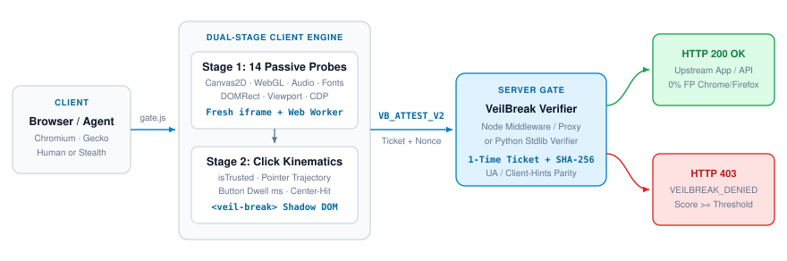

<p align="center">
  <picture>
    <source media="(prefers-color-scheme: dark)" srcset="assets/veilbreak-hero-dark.svg" />
    <source media="(prefers-color-scheme: light)" srcset="assets/veilbreak-hero-light.svg" />
    
  </picture>
</p>

<h1 align="center">VeilBreak</h1>

<p align="center">
  <a href="#live-19-browser-benchmark"></a>
  <a href="docs/invariants-and-threat-model.md"></a>
  <a href="#live-19-browser-benchmark"></a>
  <a href="#quickstart"></a>
  <a href="LICENSE"></a>
</p>

<p align="center">
  <a href="#live-19-browser-benchmark">Benchmark</a> &middot;
  <a href="#quickstart">Quickstart</a> &middot;
  <a href="#architecture">Architecture</a> &middot;
  <a href="#modes--honest-boundaries">Modes &amp; Boundaries</a> &middot;
  <a href="#documentation--ecosystem">Docs</a>
</p>

**VeilBreak** is a zero-dependency browser integrity SDK, `<veil-break>` Shadow DOM Web Component, reverse-proxy middleware, and Python verifier for detecting and blocking automated, CDP-patched, JS-spoofed, and C++-patched anti-detect browsers across Chromium and Gecko engines.

## Problem & Solution

**Problem:** Modern stealth browsers, CDP-patched automation forks, and JS evasion plugins strip `navigator.webdriver`, hide `Runtime.enable` traps, and forge User-Agent and GPU strings directly inside C++ or injected wrappers. Naive bot detectors either miss them or block unmodified desktop Chrome and Firefox visitors.

**Solution:** VeilBreak checks properties stealth frameworks struggle to keep consistent across layers: 14 cross-engine graphics, audio, font, viewport, fresh-`iframe`, and `Web Worker` invariants paired with Stage-2 click kinematics and single-use server tickets (`VB_ATTEST_V2`). In our live 19-browser Linux benchmark (`mode=strict`), both clean desktop controls passed while `15/17` automated/stealth browsers were blocked passively at Stage 1 and `17/17` were blocked when combined with Stage-2 click kinematics.

## Features

- **14 Cross-Engine Physics & Coherence Invariants**: Checks Canvas2D / `OffscreenCanvas` solid-fill noise & repeat determinism, WebGL dither-free `gl.clear(128/255)` readback & GPU hardware coherence, silent `OfflineAudioContext` noise, CSP-safe integer-DPR `DOMRect` poisoning, OS core font presence, viewport geometry impossibilities, and permissions coherence.
- **Cross-Realm & Web Worker Verification**: Uses a fresh untouched `iframe` realm and a dedicated `Web Worker` (`OffscreenCanvas` + `self.navigator`) to expose main-thread JS stealth wrappers and spoofed native getters.
- **Stage-2 Click Kinematics**: Flags untrusted synthetic DOM clicks (`isTrusted === false`) and programmatic CDP/Juggler teleport clicks (`<= 3` pointer moves, `< 12 ms` `pointerdown`→`click` dwell, dead-center hit), while exempting trusted keyboard activation (`Enter`/`Space`) and `touch`/`pen` pointers.
- **One-Time Server Tickets (`VB_ATTEST_V2`)**: Binds browser probe telemetry to single-use server tickets and client nonces via SHA-256 (with a pure-JS SHA-256 fallback on non-HTTPS origins), plus path-normalized middleware and Python `VeilBreakTicketStore` replay protection.
- **Drop-In `<veil-break>` Shadow DOM Component & Natural-Language CLI**: Gate UI sections with an XSS-safe closed Shadow DOM Web Component, integrate as Node.js/Express middleware or Python verifier, or wrap any upstream app via `node bin/veilbreak.js ask "..."`.

---

## Live 19-Browser Benchmark

Measured live against a running VeilBreak v2.0.0 server (`mode=strict`, `benchmarks/run_live_benchmark.py`, raw data in [`benchmarks/results.json`](benchmarks/results.json)). Clean Linux desktop controls (Chrome 158 and Firefox 153 ESR) were run in isolated Xvfb profiles with simulated multi-step OS pointer trajectories (`87.6–88.0 ms` dwell via `xdotool`).

- **Clean Linux Desktop Controls (`N = 2`):** **`2 / 2` ALLOWED** *(Windows, macOS, Safari/WebKit, mobile, and live privacy browsers are not yet part of this automated matrix — see [Modes & Honest Boundaries](#modes--honest-boundaries))*
- **Stage-1 Passive Detection (zero interaction):** **`15 / 17` BLOCKED (`88.2%`)** — median probe time `19.7 ms` across the 14 browsers executing JS (`15.8 ms` including `0.0 ms` HTTP-403 UA blocks; Gecko probes take `20–70 ms`)
- **Stage-1 + Stage-2 Combined (with click kinematics):** **`17 / 17` BLOCKED (`100.0%`)**

| Browser / Framework | Category | Stage 1 | Stage 2 | Key Triggered Signals |
| :--- | :--- | :-: | :-: | :--- |
| **Google Chrome 158 (Clean Desktop)** | Control | **ALLOW (`0`)** | **ALLOW (`+0`)** | `CLEAN` (`10.1 ms` probe; `13` moves, `87.6 ms` dwell) |
| **Mozilla Firefox 153 ESR (Clean Desktop)** | Control | **ALLOW (`0`)** | **ALLOW (`+0`)** | `CLEAN` (`53.0 ms` probe; `17` moves, `88.0 ms` dwell) |
| **`curl` / Python `urllib`** | Tier 1 | **BLOCK (`6`)** | `n/a` | `ATTEST_REQUIRED`, `TICKET_REPLAYED_OR_INVALID` |
| **Playwright Chromium (Headless)** | Tier 2 | **BLOCK (`6`)** | `n/a` | `AUTOMATION_UA_DENIED` (HTTP 403) |
| **Playwright Chromium (Headed)** | Tier 2 | **BLOCK (`6`)** | **BLOCK (`+4`)** | `WEBDRIVER_FLAG`, `VIEWPORT_GEOMETRY`, `TELEPORT_CLICK` |
| **Playwright Firefox 151 (Headless / Headed)** | Tier 2 | **BLOCK (`8`)** | **BLOCK (`+4`)** | `WEBDRIVER_FLAG`, `VIEWPORT_GEOMETRY`, `TELEPORT_CLICK` |
| **Playwright + `playwright-stealth`** | Tier 3 | **BLOCK (`6`)** | `n/a` | `AUTOMATION_UA_DENIED` (default headless UA -> HTTP 403) |
| **Puppeteer + `puppeteer-extra-stealth`** | Tier 3 | **BLOCK (`12`)** | **BLOCK (`+4`)** | `WORKER_REALM`, `WEBGL_HARDWARE`, `OS_FONT`, `TELEPORT_CLICK` |
| **CloakBrowser 146 (Headless / Headed)** | Tier 4a | **BLOCK (`12`/`10`)** | **BLOCK (`+4`)** | `CANVAS2D`, `WEBGL_CLEAR`, `AUDIO`, `DOMRECT`, `OS_FONT`, `TELEPORT_CLICK` |
| **Camoufox 158 (Headless)** | Tier 4a | **BLOCK (`4`)** | **BLOCK (`+4`)** | `CANVAS2D_NON_DETERMINISTIC`, `TELEPORT_CLICK` |
| **Camoufox 158 (Headed)** | Tier 4a | **ALLOW (`0`)*** | **BLOCK (`+4`)** | `TELEPORT_CLICK` *(caught at Stage 2 on interaction)* |
| **Patchright (Headless)** | Tier 4b | **BLOCK (`6`)** | `n/a` | `AUTOMATION_UA_DENIED` (HTTP 403) |
| **Patchright (Headed)** | Tier 4b | **BLOCK (`2`)**† | **BLOCK (`+4`)** | `VIEWPORT_GEOMETRY`, `TELEPORT_CLICK` |
| **Rebrowser-Playwright (Headless)** | Tier 4b | **BLOCK (`6`)** | `n/a` | `AUTOMATION_UA_DENIED` (HTTP 403) |
| **Rebrowser-Playwright (Headed)** | Tier 4b | **BLOCK (`2`)**† | **BLOCK (`+4`)** | `VIEWPORT_GEOMETRY`, `TELEPORT_CLICK` |
| **SeleniumBase UC Mode (Headed)** | Tier 4b | **BLOCK (`6`)** | **BLOCK (`+6`)** | `AUTOMATION_GLOBAL`, `VIEWPORT_GEOMETRY`, `UNTRUSTED_CLICK` |
| **Nodriver (Headed)** | Tier 4b | **ALLOW (`0`)** | **BLOCK (`+6`)** | `UNTRUSTED_SYNTHETIC_CLICK` *(caught at Stage 2)* |

*\*Camoufox (Headed) passed Stage 1 when rolling a matching-OS zero-noise profile; cross-OS / noise profiles trigger Stage 1 invariants. †Patchright & Rebrowser (Headed) were launched with default Playwright viewport settings (scoring `2` via `VIEWPORT_GEOMETRY_IMPOSSIBILITY` at Stage 1, and caught by `TELEPORT_CLICK_PHYSICS` `+4` at Stage 2 regardless of `no_viewport=True`).*

---

## Quickstart

### 1. Clone & Launch Diagnostic Playground (Zero Dependencies, Node >= 20)

```bash
git clone https://github.com/HUSMUS9999/veilbreak.git
cd veilbreak
node bin/veilbreak.js demo --port 8089 --mode strict
# Open http://127.0.0.1:8089/__veilbreak/playground
```

### 2. Natural-Language CLI (`explain` & `ask`)

```bash
# Preview the exact command first (safe dry-run)
node bin/veilbreak.js explain "block stealth browsers on http://localhost:3000 on port 8080"

# Protect any upstream web app via reverse proxy (auto-injects /__veilbreak/gate.js)
node bin/veilbreak.js ask "block stealth browsers on http://localhost:3000 on port 8080"

# Balanced mode (requires score >= 4 on physics invariants while enforcing one-time tickets)
node bin/veilbreak.js ask "protect http://localhost:3000 on port 8080 in balanced mode"
```

### 3. Drop-In HTML & `<veil-break>` Web Component

```html
<!-- Full-page automatic protection -->
<script src="/__veilbreak/gate.js" data-mode="strict" data-block-page="true"></script>

<!-- Or gate specific UI widgets inside a closed Shadow DOM component -->
<script src="/__veilbreak/gate.js" data-mode="strict" data-block-page="false"></script>
<veil-break mode="strict">
  <my-pricing-widget></my-pricing-widget>
</veil-break>
```

*Note: Light DOM children inside `<veil-break>` still exist in initial HTML until hydrated. Keep truly confidential data behind protected `/api/*` endpoints fetched after verification.*

### 4. Node.js / Express Middleware & Python Verifier

```js
const express = require("express");
const { createVeilBreakMiddleware } = require("./src/index.js");

const app = express();
app.use(createVeilBreakMiddleware({
  mode: "strict",              // "strict" (>=2) | "balanced" (>=4) | "monitor" | "off"
  protectedPaths: ["/api"],
  enablePlayground: false,     // disable diagnostic playground in production
  exposeDebugHeaders: false,   // hide scoring headers in production
  onDetect: (ev) => console.log(ev.blocked, ev.score, ev.reasons),
}));
// Note: unlike createVeilBreakServer, direct middleware does NOT auto-inject HTML;
// add <script src="/__veilbreak/gate.js"></script> to your HTML templates.
```

```python
import sys
sys.path.insert(0, "python")
from veilbreak import VeilBreakTicketStore

# One-time ticket store with full replay-protection parity
vb = VeilBreakTicketStore(mode="strict")

# 1. Serve GET /__veilbreak/ticket -> {"ok": True, "ticket": vb.mint_ticket(), "mode": "strict"}
# 2. On protected /api/* routes:
verdict = vb.verify_request(headers=dict(request.headers))
if verdict.blocked:
    return 403, {"error": "VEILBREAK_DENIED", "reasons": verdict.reasons}
```

---

## Architecture

<p align="center">
  <picture>
    <source media="(prefers-color-scheme: dark)" srcset="assets/veilbreak-arch-dark.svg" />
    <source media="(prefers-color-scheme: light)" srcset="assets/veilbreak-arch-light.svg" />
    
  </picture>
</p>

---

## Modes & Honest Boundaries

| Mode | Threshold | Behavior | Best For |
| :--- | :-: | :--- | :--- |
| `strict` *(default)* | `>= 2` | Blocks on any triggered physics/coherence invariant, automation UA, or missing/replayed ticket | Protected APIs, anti-scraping, high-value web apps |
| `balanced` | `>= 4` | Still enforces one-time tickets and automation UA denial, but requires `>= 4` on browser physics invariants (allows single `+2` Canvas-only farbling) | Public consumer sites needing headroom for single-signal farbling |
| `monitor` | `∞` | Never blocks; emits `X-VeilBreak-Score` and `onDetect` telemetry | Staging, shadow auditing, rollout verification |
| `off` | `∞` | Completely disabled | Local development & automated integration tests |

### Important Security & Operational Caveats
- **Scope of `VB_ATTEST_V2`:** `VB_ATTEST_V2` is a one-time ticketed telemetry envelope using an unkeyed SHA-256 integrity digest — NOT an unforgeable hardware proof. A motivated adversary who reverse-engineers `gate.js` can synthesize clean `VB_ATTEST_V2` headers via `curl` or a custom script. Treat VeilBreak as a high-precision friction and detection layer paired with authentication, rate limiting, and server-side business logic.
- **Open DevTools (`CDP_RUNTIME_ENABLE`):** Opening browser DevTools trips `CDP_RUNTIME_ENABLE` (`+4`). Pass `antiCdp: false` in staging/developer environments.
- **Multi-Signal Privacy Browsers:** `balanced` (`>= 4`) allows single-signal Canvas-only farbling (`+2`), but aggressive privacy browsers that simultaneously randomize Canvas + WebGL + Audio (e.g., Brave Shields Strict, LibreWolf / Firefox `privacy.resistFingerprinting`, Tor Browser) can still reach `score >= 4`. Audit with `monitor` mode first on privacy-heavy audiences.
- **`window.fetch` Auto-Attachment:** `gate.js` instruments `window.fetch()` (including `Request` and `URL` objects). Clients using `XMLHttpRequest` / Axios or plain HTML `<form>` posts should either switch to `fetch()` or call `window.VeilBreak.verify()` explicitly.
- **Multi-Worker Scaling:** Default ticket storage is process-local (`Map`); use sticky sessions behind load balancers when running multiple worker processes.

---

## Testing & Reproducing Benchmarks

```bash
# Run zero-dependency Node.js + Python parity unit & integration tests
npm test

# Reproduce the live benchmark for any installed browsers on your machine
# (missing third-party frameworks are marked SKIPPED_MISSING_TOOL, never fabricated as 403)
python3 benchmarks/run_live_benchmark.py
```

---

## Documentation & Ecosystem

- **[14 Invariants, Kinematics & Threat Model](docs/invariants-and-threat-model.md)** — Complete specification of every invariant, scoring weight, `VB_ATTEST_V2` wire format, and boundaries.
- **[Natural-Language Beginner's Guide](docs/getting-started-beginners.md)** — Copy-paste `ask`/`explain` recipes and live playground walkthrough.
- **[Live Benchmark Raw Results](benchmarks/results.json)** — Machine-readable JSON output from the 19-browser test run.

Companion repositories:
- **[Vibe-Slayer](https://github.com/HUSMUS9999/vibe-slayer)** — Zero-dependency Rust + C99 asset, binary, website/Web Component, AI weight, and zero-geometry 3D stream protection platform.
- **[ProxySnare](https://github.com/HUSMUS9999/proxysnare)** — Standalone middleware & CLI shield that detects and blocks intercepting HTTP proxies and automated repeaters.

---

## License

MIT License — see [LICENSE](LICENSE).
