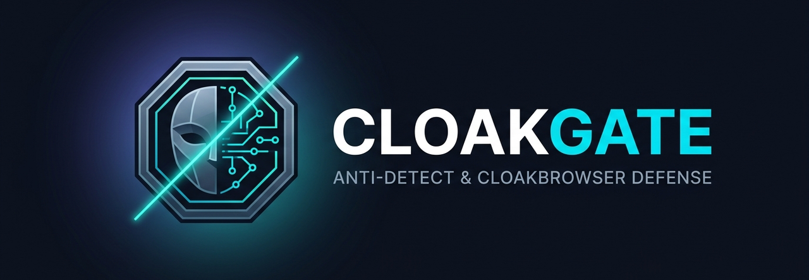

<p align="center">
  
</p>

<p align="center">
  <a href="docs/getting-started-beginners.md"></a>
  <a href="#live-verification-cloakbrowser-146-vs-chrome-158"></a>
  <a href="#live-verification-cloakbrowser-146-vs-chrome-158"></a>
  <a href="LICENSE"></a>
</p>

**Zero-dependency drop-in SDK, `<cloak-gate>` Web Component, server middleware, and plain-English CLI that detects and blocks CloakBrowser and C++-patched fingerprint-spoofing anti-detect browsers in 60 seconds.**

---

## Why CloakGate Exists

Anti-detect browsers like **CloakBrowser** patch Chromium in C++ to strip `navigator.webdriver`, hide CDP/Playwright automation flags, and spoof Windows/NVIDIA GPU profiles on Linux servers — bypassing almost every classic bot script.

**CloakGate catches CloakBrowser through 6 physical/hardware invariants** that synthetic fingerprint-noise injectors inevitably violate while real desktop browsers (Chrome, Firefox, Edge, Safari) never do:

1. **2D Canvas Solid `#808080` Flat Fill** — real GPUs/CPUs render 1 exact uniform RGB; CloakBrowser injects synthetic pixel noise (`5` unique RGBs, `+2`).
2. **WebGL `gl.clear(0.5, 0.5, 0.5, 1)` `readPixels`** — real WebGL returns 1 uniform RGB; CloakBrowser injects synthetic readback noise (`5` unique RGBs, `+2`).
3. **Silent `OfflineAudioContext` (0.0 Input Buffer)** — silence must stay `0.0`; CloakBrowser injects noise into `512/512` samples (`+2`).
4. **Integer-DPR `getBoundingClientRect()`** — a fixed `left:10px; top:20px; width:100px; height:50px` box at integer DPR must measure `[10, 20]`; CloakBrowser poisons it to `[9.953125, 19.984375]` (`+2`).
5. **OS Platform vs. Core System Fonts** — claiming `Win32`/`Windows` with `0/4` mandatory Windows fonts (`Segoe UI`, `Tahoma`, `Consolas`, `Calibri`) or `MacIntel`/`macOS` with `0/3` macOS fonts (`+2`).
6. **D3D11 NVIDIA/RTX WebGL Extension Parity** — spoofing a D3D11 NVIDIA/RTX renderer string while missing `KHR_parallel_shader_compile` (`< 30` extensions, `+1`).

Unmodified **Google Chrome 158** scores **`0 / 11`**. **CloakBrowser 146** scores **`11 / 11`** (and still scores **`8 / 11`** even with `--fingerprint-platform=linux`!).

---

## Easiest Way to Start: Plain English (`ask` & `explain`)

No security expertise needed — describe what you want in plain English:

```bash
# Preview the exact command first (dry-run)
node bin/cloakgate.js explain "block cloakbrowser on http://localhost:3000 on port 8080"

# Block CloakBrowser strictly in front of your existing app (zero code changes!)
node bin/cloakgate.js ask "block cloakbrowser on http://localhost:3000 on port 8080"

# Block CloakBrowser while keeping privacy browsers like Brave working (balanced mode)
node bin/cloakgate.js ask "block cloakbrowser on http://localhost:3000 while keeping brave working"

# Print ready-to-paste HTML, <cloak-gate>, and Express snippets
node bin/cloakgate.js ask "give me html and web component snippets"

# Launch the live 6-invariant diagnostic playground right now
node bin/cloakgate.js ask "open the live playground demo"
```

Read the **[Beginner's Guide](docs/getting-started-beginners.md)** for full step-by-step recipes.

---

## 4 Ways to Integrate (Pick One)

### 1. One-Line HTML Drop-In or `<cloak-gate>` Web Component

```html
<!-- Option A: Block CloakBrowser across the entire page -->
<script src="/__cloakgate/gate.js" data-mode="strict" data-block-page="true"></script>

<!-- Option B: Wrap any specific Web Component, checkout, or pricing widget -->
<script src="/__cloakgate/gate.js" data-mode="strict" data-block-page="false"></script>
<cloak-gate mode="strict">
  <my-protected-widget></my-protected-widget>
</cloak-gate>
```

### 2. Zero-Dependency Express / Node.js Middleware

```js
const express = require("express");
const { createCloakGateMiddleware } = require("cloakgate");

const app = express();
app.use(
  createCloakGateMiddleware({
    mode: "strict", // "off" | "monitor" | "balanced" | "strict"
    protectedPaths: ["/api"],
    onDetect: (ev) => console.warn("[CloakGate]", ev.blocked ? "BLOCKED" : "FLAG", ev.reasons),
  })
);
```

### 3. Standalone Zero-Code Reverse Proxy (Works With React, Next.js, Django, Go, Rails, PHP)

```bash
node bin/cloakgate.js protect --target http://127.0.0.1:3000 --port 8080 --mode strict --paths /api
```

### 4. Python Stdlib Verifier (`python/cloakgate.py`)

```python
from cloakgate import verify_cloak_attestation

verdict = verify_cloak_attestation(
    mode="strict",
    headers=dict(request.headers),
    attest=request.headers.get("X-CG-Attest"),
    ticket=request.headers.get("X-CG-Ticket", ""),
    nonce=request.headers.get("X-CG-Nonce", ""),
)
if verdict.blocked:
    return 403, {"error": "CLOAK_BROWSER_DENIED", "reasons": verdict.reasons}
```

---

## Live Verification: CloakBrowser 146 vs. Chrome 158

Empirically tested live against `cloakgate demo --mode strict` and `--mode balanced`:

| Check | Live CloakBrowser 146 (`chromium-146.0.7680.177.5`) | Live Google Chrome 158 |
| :--- | :--- | :--- |
| **Live 6-Invariant Score (`/__cloakgate/playground`)** | **`11 / 11` — DENIED (`CLOAK_BROWSER_DENIED`)** | **`0 / 11` — ALLOWED (`CLEAN`)** |
| **Protected Page Auto-Block (`data-block-page="true"`)** | **Page wiped & blocked (`CLOAK_BROWSER_DENIED`)** | **Full page content rendered (`0` false positives)** |
| **`<cloak-gate>` Shadow DOM Web Component** | **Child wiped & blocked (`dataset.cloakgateStatus="blocked"`)** | **Child rendered cleanly (`dataset.cloakgateStatus="allowed"`)** |
| **Protected `/api/secret` Endpoint** | **`403 CLOAK_BROWSER_DENIED`** | **`200 OK`** |

---

## Choosing `balanced` vs. `strict`

| Mode | Score Threshold | Server Attestation | Brave Aggressive Farbling (`+2`) | CloakBrowser 146 (`11/11` or `8/11`) |
| :--- | :---: | :---: | :---: | :---: |
| **`monitor`** | Log only | Optional | Allowed | Logged only |
| **`balanced`** | `>= 4` | Checked if sent | **Allowed** | **100% Blocked** |
| **`strict`** *(default)* | `>= 2` | **Mandatory single-use ticket + SHA-256 attest + Headless UA block** | Flagged (`2 >= 2`) | **100% Blocked** |

Read **[Hardware Invariants & Honest Threat Model](docs/invariants-and-threat-model.md)** for full probe details and honest limitations.

---

## Run Tests

```bash
npm test
```

## Related Projects

- **[Vibe-Slayer](https://github.com/HUSMUS9999/vibe-slayer)** — Zero-dependency Rust + C99 asset, binary, Web Component, and zero-geometry 3D stream protection platform.
- **[ProxySnare](https://github.com/HUSMUS9999/proxysnare)** — Detect and block Caido Repeater, Burp Suite Repeater, and intercepting HTTP proxies.
