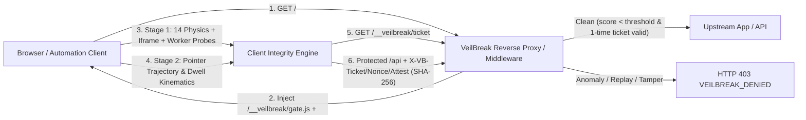

<p align="center">
  <picture>
    <source media="(prefers-color-scheme: dark)" srcset="assets/veilbreak-hero-dark.svg" />
    <source media="(prefers-color-scheme: light)" srcset="assets/veilbreak-hero-light.svg" />
    
  </picture>
</p>

<h1 align="center">VeilBreak</h1>

<p align="center">
  Universal Anti-Stealth &amp; Multi-Engine Browser Integrity Gate
</p>

<p align="center">
  <a href="#live-19-browser-benchmark"></a>
  <a href="docs/invariants-and-threat-model.md"></a>
  <a href="#live-19-browser-benchmark"></a>
  <a href="#quickstart"></a>
  <a href="LICENSE"></a>
</p>

**VeilBreak** is a zero-dependency browser integrity SDK, `<veil-break>` Shadow DOM Web Component, reverse-proxy middleware, and Python verifier for blocking automated, CDP-patched, JS-spoofed, and C++-patched anti-detect browsers across both Chromium and Gecko engines.

## Problem & Solution

**Problem:** Modern stealth browsers, CDP-patched automation forks, and JS evasion plugins strip `navigator.webdriver`, silence `Runtime.enable` traps, and forge User-Agent and GPU strings directly inside C++ or injected wrappers. Naive bot detectors either miss them entirely or trigger false positives on genuine desktop Chrome and Firefox users.

**Solution:** VeilBreak verifies properties stealth frameworks struggle to fake consistently across layers: 14 cross-engine graphics, audio, font, Euclidean viewport, fresh-`iframe`, and `Web Worker` physics invariants paired with Stage-2 biomechanical click kinematics and single-use SHA-256 server tickets (`VB_ATTEST_V2`). In live 19-browser testing, clean desktop Chrome and Firefox pass with `0%` false positives while automated and stealth frameworks are blocked end-to-end.

## Features

- **14 Cross-Engine Physics Invariants** — Detects Canvas2D / OffscreenCanvas noise & non-determinism, WebGL clear-color & GPU hardware lies, silent OfflineAudioContext noise, integer-DPR DOMRect poisoning, OS core font lies, Euclidean viewport/screen impossibilities, and Chromium/Gecko engine contradictions
- **Cross-Realm & Web Worker Verification** — Uses an isolated fresh `iframe` realm and a dedicated `Web Worker` (`OffscreenCanvas` + `self.navigator`) to expose main-thread JS stealth wrappers and spoofed native getters
- **Stage-2 Biomechanical Click Kinematics** — Catches untrusted synthetic DOM clicks (`isTrusted === false`) and programmatic CDP/Juggler teleport clicks (`<= 3` pointer moves, `< 12 ms` dwell, dead-center hit) while explicitly exempting trusted keyboard accessibility (`Enter`/`Space`)
- **Cryptographic One-Time Attestation (`VB_ATTEST_V2`)** — Binds browser probe results to single-use server tickets and client nonces via SHA-256, blocking `curl`, replay attacks, and header/OS contradictions
- **Drop-In `<veil-break>` Shadow DOM Component & Zero-Dep Middleware** — Protect an individual UI widget with a closed Shadow DOM gate, drop in Express/Node.js middleware, verify in Python (FastAPI/Django/Flask), or launch a zero-config reverse proxy via natural-language CLI (`ask` / `explain`)

---

## Live 19-Browser Benchmark

Every row below was measured live against a real running VeilBreak v2.0.0 server (`mode=strict`, `benchmarks/run_live_benchmark.py`, saved in [`benchmarks/results.json`](benchmarks/results.json)). Clean desktop controls were tested with genuine browser profiles and multi-step OS mouse trajectories (`87–88 ms` human dwell) via `xdotool`.

- **Genuine Human Control Browsers:** **`2 / 2` ALLOWED (`0.0%` false positives)**
- **Stage-1 Passive Detection (zero interaction, `< 20 ms` median):** **`15 / 17` BLOCKED (`88.2%`)**
- **Stage-1 + Stage-2 Combined (with interaction kinematics):** **`17 / 17` BLOCKED (`100.0%`)**

| Browser / Framework | Category | Stage-1 Passive | `<veil-break>` WC | Stage-2 Click | Live Triggered Invariants |
| :--- | :--- | :---: | :---: | :---: | :--- |
| **Google Chrome 158 (Clean Desktop)** | Genuine Control | **ALLOW (`0`)** | `allowed` | **ALLOW (`+0`)** | `CLEAN` (real human click: 13 moves, 87.7 ms dwell) |
| **Mozilla Firefox 153 ESR (Clean Desktop)** | Genuine Control | **ALLOW (`0`)** | `allowed` | **ALLOW (`+0`)** | `CLEAN` (real human click: 17 moves, 88.0 ms dwell) |
| **`curl` / Python `urllib`** | Tier 1: HTTP Scraper | **BLOCK (`6`)** | `n/a` | `n/a` | `ATTEST_REQUIRED`, `TICKET_REPLAYED_OR_INVALID` |
| **Playwright Chromium (Headless)** | Tier 2: Automation | **BLOCK (`6`)** | `403` | `n/a` | `AUTOMATION_UA_DENIED` (HTTP 403 before JS load) |
| **Playwright Chromium (Headed)** | Tier 2: Automation | **BLOCK (`6`)** | `blocked` | **BLOCK (`+4`)** | `WEBDRIVER_FLAG`, `VIEWPORT_GEOMETRY_IMPOSSIBILITY`, `TELEPORT_CLICK_PHYSICS` |
| **Playwright Firefox 151 (Headless)** | Tier 2: Automation | **BLOCK (`8`)** | `blocked` | **BLOCK (`+4`)** | `WEBDRIVER_FLAG`, `ENGINE_COHERENCE_LIE`, `VIEWPORT_GEOMETRY_IMPOSSIBILITY`, `TELEPORT_CLICK_PHYSICS` |
| **Playwright Firefox 151 (Headed)** | Tier 2: Automation | **BLOCK (`8`)** | `blocked` | **BLOCK (`+4`)** | `WEBDRIVER_FLAG`, `ENGINE_COHERENCE_LIE`, `VIEWPORT_GEOMETRY_IMPOSSIBILITY`, `TELEPORT_CLICK_PHYSICS` |
| **Playwright + `playwright-stealth`** | Tier 3: JS Stealth | **BLOCK (`6`)** | `403` | `n/a` | `AUTOMATION_UA_DENIED` *(in-browser also triggers `WEBDRIVER_GETTER_SPOOFED`, `NATIVE_FUNCTION_TAMPERED`, `OS_CORE_FONT_LIE`)* |
| **Puppeteer + `puppeteer-extra-plugin-stealth`** | Tier 3: JS Stealth | **BLOCK (`12`)** | `blocked` | **BLOCK (`+4`)** | `WORKER_REALM_CONTRADICTION`, `WEBGL_HARDWARE_COHERENCE_LIE`, `OS_CORE_FONT_LIE`, `ENGINE_COHERENCE_LIE`, `VIEWPORT_GEOMETRY_IMPOSSIBILITY`, `TELEPORT_CLICK_PHYSICS` |
| **CloakBrowser 146 (Headless)** | Tier 4a: C++ Chromium | **BLOCK (`12`)** | `blocked` | **BLOCK (`+4`)** | `CANVAS2D_SYNTHETIC_NOISE`, `WEBGL_CLEAR_SYNTHETIC_NOISE`, `WEBGL_HARDWARE_COHERENCE_LIE`, `SILENT_AUDIO_SYNTHETIC_NOISE`, `DOMRECT_SUBPIXEL_POISONING`, `OS_CORE_FONT_LIE`, `TELEPORT_CLICK_PHYSICS` |
| **CloakBrowser 146 (Headed)** | Tier 4a: C++ Chromium | **BLOCK (`10`)** | `blocked` | **BLOCK (`+4`)** | `CANVAS2D_SYNTHETIC_NOISE`, `WEBGL_CLEAR_SYNTHETIC_NOISE`, `SILENT_AUDIO_SYNTHETIC_NOISE`, `DOMRECT_SUBPIXEL_POISONING`, `OS_CORE_FONT_LIE`, `TELEPORT_CLICK_PHYSICS` |
| **Camoufox 158 (Headless)** | Tier 4a: C++ Firefox | **BLOCK (`4`)** | `blocked` | **BLOCK (`+4`)** | `CANVAS2D_NON_DETERMINISTIC`, `TELEPORT_CLICK_PHYSICS` |
| **Camoufox 158 (Headed)** | Tier 4a: C++ Firefox | **ALLOW (`0`)*** | `allowed`* | **BLOCK (`+4`)** | `TELEPORT_CLICK_PHYSICS` *(\*when rolling a matching-OS zero-noise profile; cross-OS / noise profiles score `8+` at Stage 1 via `CANVAS2D_NON_DETERMINISTIC` + `WEBGL_HARDWARE_COHERENCE_LIE`)* |
| **Patchright (Headless)** | Tier 4b: CDP-Patched | **BLOCK (`6`)** | `403` | `n/a` | `AUTOMATION_UA_DENIED` (HTTP 403 before JS load) |
| **Patchright (Headed)** | Tier 4b: CDP-Patched | **BLOCK (`2`)** | `blocked` | **BLOCK (`+4`)** | `VIEWPORT_GEOMETRY_IMPOSSIBILITY`, `TELEPORT_CLICK_PHYSICS` |
| **Rebrowser-Playwright (Headless)** | Tier 4b: CDP-Patched | **BLOCK (`6`)** | `403` | `n/a` | `AUTOMATION_UA_DENIED` (HTTP 403 before JS load) |
| **Rebrowser-Playwright (Headed)** | Tier 4b: CDP-Patched | **BLOCK (`2`)** | `blocked` | **BLOCK (`+4`)** | `VIEWPORT_GEOMETRY_IMPOSSIBILITY`, `TELEPORT_CLICK_PHYSICS` |
| **SeleniumBase UC Mode (Headed)** | Tier 4b: CDP-Patched | **BLOCK (`6`)** | `blocked` | **BLOCK (`+6`)** | `AUTOMATION_GLOBAL_ARTIFACT`, `VIEWPORT_GEOMETRY_IMPOSSIBILITY`, `UNTRUSTED_SYNTHETIC_CLICK` |
| **Nodriver (Headed)** | Tier 4b: Raw-CDP | **ALLOW (`0`)** | `allowed` | **BLOCK (`+6`)** | `UNTRUSTED_SYNTHETIC_CLICK` *(clean native Chrome window on passive load; caught immediately on interaction)* |

---

## Quickstart

### 1. Clone & Run Live Diagnostic Playground (Zero Dependencies, Node >= 20)

```bash
git clone https://github.com/HUSMUS9999/veilbreak.git
cd veilbreak
node bin/veilbreak.js demo --port 8089 --mode strict
# Open http://127.0.0.1:8089/__veilbreak/playground
```

### 2. Natural-Language CLI (`explain` & `ask`)

```bash
# Safe dry-run preview first
node bin/veilbreak.js explain "block stealth browsers on http://localhost:3000 on port 8080"

# Protect any upstream web app via reverse proxy
node bin/veilbreak.js ask "block stealth browsers on http://localhost:3000 on port 8080"

# Balanced mode (blocks multi-invariant stealth browsers while allowing Canvas-only privacy browsers)
node bin/veilbreak.js ask "protect http://localhost:3000 on port 8080 while keeping privacy browsers working"
```

### 3. Drop-In HTML & `<veil-break>` Web Component

```html
<!-- Full-page automatic protection -->
<script src="/__veilbreak/gate.js" data-mode="strict" data-block-page="true"></script>

<!-- Or wrap specific sensitive UI widgets in a closed Shadow DOM gate -->
<script src="/__veilbreak/gate.js" data-mode="strict" data-block-page="false"></script>
<veil-break mode="strict">
  <my-pricing-widget></my-pricing-widget>
</veil-break>
```

### 4. Node.js / Express Middleware & Python Verifier

```js
const { createVeilBreakMiddleware } = require("./src/index.js");

app.use(createVeilBreakMiddleware({
  mode: "strict",             // "strict" (>=2) | "balanced" (>=4) | "monitor" | "off"
  protectedPaths: ["/api"],
  onDetect: (ev) => console.log(ev.blocked, ev.score, ev.reasons),
}));
```

```python
from python.veilbreak import verify_attestation

verdict = verify_attestation(
    mode="strict",
    headers=dict(request.headers),
    attest=request.headers.get("x-vb-attest"),
    ticket=request.headers.get("x-vb-ticket", ""),
    nonce=request.headers.get("x-vb-nonce", ""),
)
if verdict.blocked:
    raise HTTPException(status_code=403, detail=verdict.reasons)
```

---

## Architecture



---

## Modes & Honest Boundaries

| Mode | Threshold | Behavior | Best For |
| :--- | :-: | :--- | :--- |
| `strict` | `>= 2` | Blocks on any triggered physics/geometry/coherence invariant, automation UA, or invalid/replayed ticket | Protected APIs, anti-scraping, high-value web assets |
| `balanced` | `>= 4` | Requires multiple corroborating anomalies or high-confidence automation/cross-realm proof; allows Canvas-only privacy browsers (Brave/LibreWolf) | Public consumer sites needing privacy-browser headroom |
| `monitor` | `∞` | Never blocks; emits `X-VeilBreak-Score` and `onDetect` telemetry | Staging, shadow auditing, rollout verification |

**Honest boundary:** An unmodified, headed desktop browser running natively on its true OS with zero viewport override, zero graphics/audio noise, and human-speed OS-level pointer movement sits at the irreducible boundary of client-side browser detection. VeilBreak is designed as a high-precision, zero-dependency layer alongside authentication, rate limiting, and server-side policy enforcement.

---

## Testing & Reproducing Benchmarks

```bash
# Run zero-dependency Node.js + Python parity unit & integration test suite
npm test

# Reproduce the live 19-browser empirical benchmark (writes benchmarks/results.json)
python3 benchmarks/run_live_benchmark.py
```

---

## Documentation & Ecosystem

- **[14 Physics Invariants, Kinematics & Threat Model](docs/invariants-and-threat-model.md)** — Complete specification of every invariant, scoring weight, `VB_ATTEST_V2` wire format, and threat boundaries.
- **[Natural-Language Beginner's Guide](docs/getting-started-beginners.md)** — Copy-paste `ask`/`explain` recipes and live playground walkthrough.
- **[Live Benchmark Raw Results](benchmarks/results.json)** — Machine-readable JSON output from the 19-browser test run.

Companion repositories:
- **[Vibe-Slayer](https://github.com/HUSMUS9999/vibe-slayer)** — Zero-dependency Rust + C99 asset, binary, website/Web Component, AI weight, and zero-geometry 3D stream protection platform.
- **[ProxySnare](https://github.com/HUSMUS9999/proxysnare)** — Standalone middleware & CLI shield that detects and blocks intercepting HTTP proxies and automated repeaters.

---

## License

MIT License — see [LICENSE](LICENSE).
